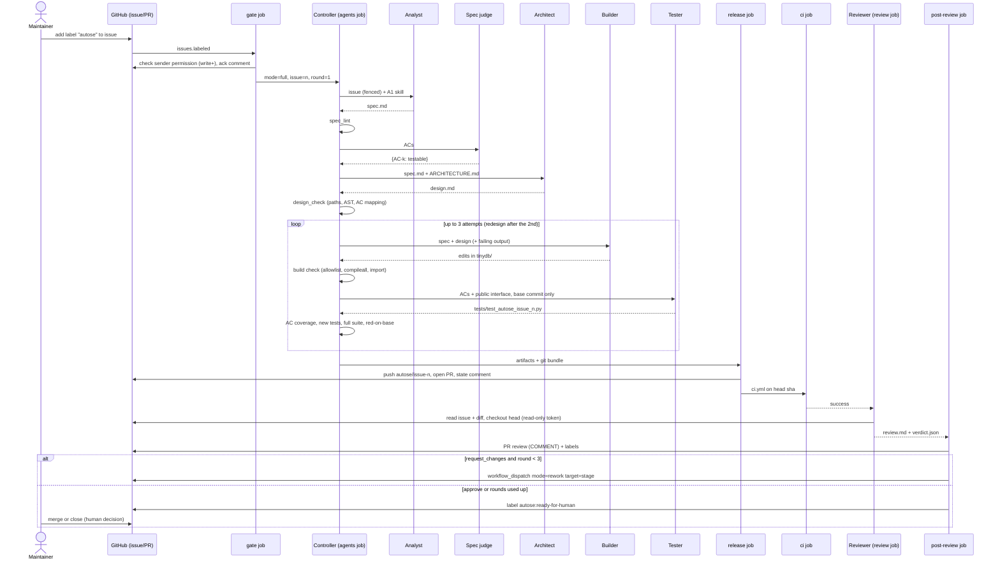

# Sequence view

**Status:** planned sequence (design-time). This file is replaced by the sequence of one *real* run
(issue → PR → review, with run/PR links and timings taken from `state.json`) once that run exists.

